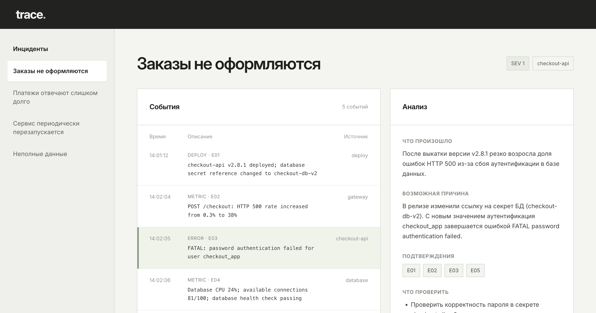

# Trace

Приложение для анализа технических инцидентов с помощью Gemini.

Trace собирает события, логи и метрики в одну ленту. На их основе модель
предлагает возможную причину сбоя, указывает связанные события и подсказывает,
что проверить дальше.



## Возможности

- Выбор одного из четырёх подготовленных сценариев.
- Просмотр логов, метрик и событий в хронологическом порядке.
- Анализ инцидента с помощью Gemini.
- Ссылки на события, которые модель использовала в выводе.
- Подсветка события при нажатии на его номер.
- Отдельный сценарий с недостаточным количеством данных.

## Как это работает

1. Выбираете инцидент.
2. Приложение отправляет события выбранного сценария в Gemini.
3. Модель возвращает гипотезу, подтверждающие события и следующие шаги.
4. Ссылки на события можно открыть прямо в ленте.

## Технологии

- Python и стандартная библиотека
- Gemini API
- HTML, CSS и JavaScript

## Запуск

Нужен Python 3.9 или новее и ключ Gemini API.

1. Клонируйте репозиторий:

   ```bash
   git clone https://github.com/therealfullmetal55555/trace-incident-investigator.git
   cd trace-incident-investigator
   ```

2. Создайте файл `.env` в папке проекта:

   ```text
   GEMINI_API_KEY=ваш-ключ
   ```

   Ключ можно получить в [Google AI Studio](https://aistudio.google.com/apikey).

3. Запустите приложение:

   ```bash
   python3 app.py
   ```

4. Откройте в браузере:

   ```text
   http://localhost:8000
   ```

По умолчанию используется модель `gemini-2.5-flash`. Без API-ключа можно
просматривать сценарии, но запустить анализ не получится.

## Тесты

```bash
python3 -m unittest discover -s tests -v
```

Тесты проверяют структуру сценариев, обработку некорректных ответов модели
и фильтрацию ссылок на несуществующие события.

## Ограничения

Trace находится на стадии прототипа. Сейчас приложение работает с
подготовленными сценариями: загрузка собственных логов и автоматическая
оценка качества ответов ещё не реализованы.

Модель получает события одним запросом. Её выводы нужно проверять по
исходным данным: ссылка на событие сама по себе не гарантирует правильность
гипотезы.

Сервер рассчитан на локальный запуск. Данные сценария отправляются в Gemini,
поэтому перед использованием реальных логов нужно проверить, нет ли в них
конфиденциальной информации.
